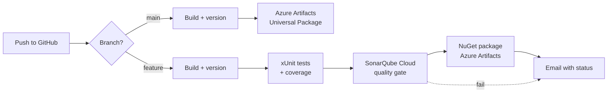

# Azure Hello World

[](https://sonarcloud.io/project/overview?id=daveops-app_Azure-hello-world)
[](https://sonarcloud.io/project/overview?id=daveops-app_Azure-hello-world)

Azure DevOps home assignment: a .NET 10 "Hello World" app with CI/CD pipelines for build, versioning, testing, code analysis and publishing.

## How it works



The project has two pipelines.

**`artifact-upload-pipeline.yml`** runs on `main`. Builds the app, increments the version with a pipeline counter (1.0.1, 1.0.2, ...) and uploads it to Azure Artifacts as a Universal Package.

**`SonarQube-pipeline.yml`** runs on `feature`. Builds the app, runs the unit tests with coverage and scans the code with SonarQube Cloud. If the quality gate passes, it packs a NuGet package and pushes it to the Azure Artifacts feed. An email with the pipeline status is sent at the end of every run.

## Structure

```
HelloWorld/          the app
HelloWorld.Tests/    xUnit tests
```

## Run locally

```bash
dotnet run --project HelloWorld
dotnet test HelloWorld.Tests
```
